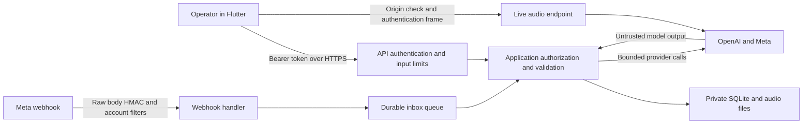

# Voice Notes security design

Date: 2026-11-02
Scope: Flutter client, FastAPI API, live audio, WhatsApp webhook and follow-ups, local SQLite/audio storage
Status: implementation and regression tests added; four storage tests passed; full runtime verification pending

## 1. Security decision

This application currently has one trusted operator and one backend owner. Anyone possessing `APP_ACCESS_TOKEN` has access to all contacts, transcripts, settings, and send operations. This is the supported prototype boundary. It does not provide staff accounts, roles, patient-level access controls, or tenant isolation.

The immediate changes strengthen that boundary without introducing an incomplete identity system:

- Authenticate API requests before reading their bodies, and bound ingestion before multipart or JSON parsing.
- Treat model responses and client-supplied chat history as untrusted data. They cannot grant or revoke contact permission.
- Require the operator to select permission status and supply its source when granting it. Keep invitation preview and send confirmation separate.
- Preserve the existing server checks on consent, recipient allowlists, verified templates, and duplicate send attempts.
- Restrict permissions on local databases and newly saved audio.
- Add offline adversarial regression tests and a CI definition.

The implementation is suitable for review, but is not a production security certification. Four standalone storage tests passed. The full backend suite, the Flutter analyzer/tests, and dependency auditing have not yet run in the current restricted environment.

## 2. Assets and trust boundaries

Protected data includes audio, transcripts, translations, full telephone numbers, contact consent evidence, follow-up records, API credentials, and the ability to send messages or incur provider costs. A recording or reply may contain health information even when the application does not explicitly ask for it.



Public ingress is hostile until authenticated. A valid Meta signature proves which app signed a payload, not that the payload belongs to the configured WABA, phone, sender, or business workflow. Those filters remain separate. A model response is never evidence of permission. A trusted local OS administrator can still read the service's data and credentials.

## 3. Threat model and current controls

| Threat | Control in this change or existing code | Remaining boundary |
| --- | --- | --- |
| Anonymous access to transcripts or paid APIs | Bearer validation for `/api` and `/api/*`, before body reads; missing server token fails closed | A stolen shared token gives full operator access; no user attribution or revocation per device |
| Memory/disk exhaustion through uploads or large JSON | Actual streamed bytes counted before parsing; bounded temporary spool; 30-second read deadline; eight admitted HTTP requests per process | Proxy and network connection limits are still needed; limits multiply with worker count |
| Spoofed length or compressed request bypass | Duplicate/invalid lengths, conflicting transfer encoding, mismatched lengths, and compressed API bodies rejected | The HTTP server/proxy must reject ambiguous wire framing before ASGI |
| Cross-site browser access | Exact configured CORS origins; independent WebSocket origin check; browser token sent in an initial frame | CORS is not authentication; native callers can omit Origin |
| Oversized live messages | Authentication JSON limited to 4 KiB; control JSON to 256 bytes; existing PCM frame, total byte, and session duration limits | Application checks occur after frame delivery; configure server frame/queue limits and session admission |
| Forged, wrong-account, or replayed webhooks | Existing raw-body HMAC, account/phone/sender filters, age checks, durable message deduplication | HMAC alone does not prevent replay; events missing optional IDs/timestamps have weaker replay protection |
| Media SSRF or token forwarding | Existing trusted HTTPS Meta host checks, forbidden credentials/ports, redirects disabled | Egress policy and DNS protections remain deployment responsibilities |
| Malicious media | File size limits, generated filenames, bounded FFmpeg conversion, no shell execution, restricted FFmpeg protocols | Content sniffing, decoder isolation, and patched FFmpeg remain required before broad exposure |
| Prompt injection granting contact permission | Local strict schema validation; model-created contacts always start `unknown`; model permission updates only return a confirmation card | AI can still propose or create internal contacts/drafts; their correctness needs operator review |
| Unintended or repeated outbound send | Existing verified template snapshot, transactional consent/allowlist checks, durable send-attempt reservation | No atomic transaction with Meta; an uncertain result must be reconciled, not blindly retried |
| Local data exposure | Database mode `0600`; new audio created with `0600`; new storage directories use `0700`; generated extension validated | File permissions do not encrypt data; older audio, parent directories, backups, and local administrators require separate handling |
| Secret disclosure | Existing provider error sanitization, safe webhook diagnostic messages, in-memory frontend token; new API response privacy headers | Proxy/access logs and unexpected server exception logs require redaction review |
| Excess retention | Existing 24-hour inbox cleanup and seven-day tombstones; deleted inbox rows now clear their audio-path reference | Persisted audio, feedback, contacts, and follow-ups have no automatic retention/deletion lifecycle |

## 4. Request admission design

`backend/security.py` is a pure ASGI middleware placed inside CORS handling and outside route parsing. A valid preflight does not execute an API operation. An ordinary `OPTIONS` request still requires authentication.

Processing order:

1. Require exactly one valid Authorization header. Reject before any body read.
2. Validate framing metadata. Reject declared oversize bodies immediately.
3. Reserve one of eight process-local HTTP slots, otherwise return `429` with `Retry-After: 5`.
4. Read actual bytes within 30 seconds. Keep at most 64 KiB of spool data in memory before using a private temporary file.
5. Reject actual oversize bodies or a declared/actual length mismatch before handing data to FastAPI.
6. Replay accepted bytes to the route and release the spool and slot on completion, disconnect, timeout, cancellation, or failure.

| Input | Application limit |
| --- | --- |
| `/api/transcribe` complete multipart body | `MAX_UPLOAD_BYTES + 65,536` bytes |
| Uploaded audio inside the multipart body | Existing `MAX_UPLOAD_MB`, default 20 decimal MB, configurable from 1–25 MB |
| Other API request bodies | 65,536 bytes |
| Active HTTP API requests | 8 per process, including ingestion and route execution |
| Body ingestion | 30 seconds |
| WebSocket auth frame | 4,096 UTF-8 bytes; existing 10-second authentication deadline |
| WebSocket control frame | 256 UTF-8 bytes |
| Live PCM frame | Existing 48,000-byte maximum, nonempty and even byte count |
| Live session | Existing 600 seconds and corresponding PCM byte budget |

The spool prevents oversized multipart input from reaching the multipart parser. Accepted uploads can temporarily occupy both the middleware spool and the parser's upload spool; budget disk for both. The ASGI server still allocates received chunks, so this is not an absolute host memory ceiling. The HTTP admission limit does not limit WebSockets, unauthenticated traffic, webhook connections, or aggregate provider spend.

API responses passing through the middleware, including authentication errors, carry `Cache-Control: no-store`, `X-Content-Type-Options: nosniff`, and `Referrer-Policy: no-referrer`. Successful webhook verification also carries these headers. An unexpected error generated outside the middleware may need equivalent headers at the proxy.

## 5. Consent and outbound actions

### Consent flow implemented here

1. AI may extract a contact name and number. A contact it creates always has permission `unknown`, regardless of model output or forged chat history.
2. AI may propose an update, but cannot write a permission change.
3. The operator opens **Record permission**, reviews the contact and full number, and selects **Agreed**, **Opted out**, or **Unknown**. Nothing is preselected.
4. Granting permission requires a nonblank source entered by the operator. The existing authenticated `/api/whatsapp/contacts/consent` endpoint validates and saves it.
5. The operator creates a fresh follow-up to see its verified recipient and template preview, then separately selects **Confirm and send**.

The typed contact-creation API can also record operator-supplied permission, but now rejects `granted` without a source. The shared token remains the authorization boundary: this does not prevent a malicious token holder from submitting a false claim, and a source string is not independently verified proof of consent. A production consent record needs an actor, time, provenance, and an append-only change history.

Strict local Pydantic validation constrains allowed intents, field types, lengths, language, and permission values before business logic runs. Provider-side structured output is useful formatting assistance, not a trusted security control. Prompt wording is defense in depth only.

### Existing send protections retained and covered by new tests

- Preparing a draft never calls the outbound messages endpoint.
- Only a draft for a currently consenting, allowed contact can be sent.
- The approved template and sending account are verified again; a changed snapshot blocks sending.
- Consent is rechecked in the reservation transaction after template verification.
- A durable outbound attempt prevents duplicate confirmation from sending twice.
- A timeout is recorded as `unknown`; retrying the same draft is blocked pending reconciliation.

Consent can still change after reservation while a provider call is in flight. Once Meta accepts a message, the application cannot recall it. Future multi-user work should define the reservation as the authorization cutoff, serialize consent changes with dispatch, and record that cutoff in the audit trail. A future confirmation capability should bind the operator, recipient ID and phone, consent revision, template/account hash, expiry, and one-use nonce; this is not implemented here.

## 6. Data lifecycle design

### Current behavior

| Store | Current lifecycle |
| --- | --- |
| Inbox queue/results | Content expires after 24 hours; deduplication tombstones remain up to seven days |
| `voice_feedback` records and saved audio | Persist until explicitly managed; the inbox expiry does not delete them |
| Contacts, follow-up tasks and message metadata | Persist; no automatic expiry |
| Saved follow-up reply content | Persist when saving is enabled; no separate automatic expiry |
| Live audio | Relayed; the backend does not save live PCM |
| Live transcript/translation | Saved when the global save setting permits it |

The save setting defaults to enabled in the existing database initializer. Turning it off affects new persistence; it is not erasure of existing data. Privacy decisions should not assume it is a consent control. This change does not delete existing records or change that default.

### Required production lifecycle

Adopt a configurable retention policy approved for the intended service. Define separate durations for raw audio, derived text, operational metadata, consent evidence, audit events, and backups. Do not use the inbox's 24-hour period as a blanket claim for all storage.

Introduce a deletion job that inventories the feedback row, audio object, inbox copy, follow-up text, caches, and exports. Record a deletion tombstone before cleanup; workers must check it before each persistence step so an in-flight transcription cannot recreate deleted content. A retryable deletion job should remove every content copy and record a non-content completion receipt. Minimal deduplication identifiers may remain under an explicitly documented policy.

Acceptance tests must cover deletion during download/transcription, worker restart, replayed webhooks after deletion, partial cleanup failure, backup restoration, and saving being disabled during an active operation. Backups need encryption, expiry, and a process that reapplies deletion tombstones after restore. Provider-held copies require a separate retention and deletion agreement; local deletion does not erase Meta or OpenAI data.

## 7. Production requirements and priority

| Priority | Work | Acceptance condition |
| --- | --- | --- |
| P0 — before release of these changes | Run backend suite, Flutter analyzer/widget tests/build, and dependency audit | Recorded passing results; any failures resolved; no real provider traffic |
| P0 — before public deployment | TLS reverse proxy, explicit public route allowlist, trusted forwarded headers, connection/rate/body/time limits | Unauthenticated probes cannot reach private data; spoofed forwarding headers cannot evade limits |
| P0 — before multiple operators | OIDC/OAuth login, short-lived access tokens, role and record ownership checks | Two-user/two-tenant tests prove cross-account reads, writes, socket access, and sends are denied |
| P0 — before real sensitive data | Retention/deletion design above, encryption at rest and in backups, key management, consent and provider data agreements | Demonstrated deletion/restore workflow and reviewed access/data policy |
| P1 | Shared rate/cost limits, WebSocket admission, decoder isolation, storage quotas | Bounded abusive/parallel workloads; spent budget cannot multiply across workers |
| P1 | Actor-based audit trail and dispatch/consent revision controls | Traceable consent changes and send authorization without storing message content in logs |
| P1 | Locked dependencies, commit-pinned CI actions, secret scanning, scheduled vulnerability review | Reproducible dependency set; no unreviewed critical/high findings or committed credentials |
| P1 | Strict webhook schema and durable text/status reconciliation | Malformed events fail safely; no acknowledged but lost follow-up updates; replay policy for missing IDs/timestamps defined |

For the existing Uvicorn WebSocket implementation, a deployment starting point is `--ws websockets --ws-max-size 65536 --ws-max-queue 4`, with per-principal live-session limits at the gateway. Confirm these options against the deployed Uvicorn version and implementation. Terminate TLS at the configured proxy and keep backend access private. Do not enable HSTS on local HTTP development endpoints.

Use dedicated service credentials and an OS service account, explicit web origins, a restricted sender allowlist during trials, and separate Meta/OpenAI/app tokens. Keep access logs from recording the webhook verification query token. Monitor authentication failures, signature failures, request rejection counts, queue saturation, provider errors, and spend using aggregate counters without audio, transcript text, tokens, or full phone numbers.

## 8. Verification plan and evidence

New tests intentionally use malformed inputs and state changes at authorization boundaries. They do not depend on a live model producing a particular response.

| Coverage | Test location |
| --- | --- |
| Route-wide HTTP authentication; early rejection; oversized and chunked bodies; spoofed lengths; timeouts and concurrency cleanup | `backend/tests/test_security.py` |
| Bad/oversized WebSocket authentication frames | `backend/tests/test_security.py` |
| Storage permissions, extension handling, partial-copy cleanup, and disabled live persistence | `backend/tests/test_storage_security.py` |
| Injected consent, forged assistant history, strict model-output validation, consent evidence | `backend/tests/test_followup_security.py` |
| Preview without send, one send per draft, uncertain outcomes, revoked consent, changed templates and allowlists | `backend/tests/test_followup_security.py` |
| Additional SSRF destinations, including loopback and metadata services | `backend/tests/test_whatsapp.py` |
| Operator selection and evidence required before saving permission; saving does not send | `frontend/test/consent_test.dart` |
| Existing upload/live/webhook/queue/provider-error behaviors | Existing backend and Flutter suites |

`backend/tests/conftest.py` disables dotenv loading before application import, removes inherited provider credentials from the test process, assigns temporary storage, and blocks outbound socket connections. HTTP providers must use mocks. This deliberately turns accidental external traffic into a test failure.

Run from a permitted development environment:

```bash
cd backend
.venv/bin/python -m pip install -r requirements-dev.txt
PYTHON_DOTENV_DISABLED=1 .venv/bin/python -m pytest -q

cd ../frontend
flutter analyze
flutter test
flutter build web --release
```

`.github/workflows/security-tests.yml` defines backend tests on Python 3.11 and 3.13 with FFmpeg, plus a dependency audit. It uses read-only repository permissions and does not provide application secrets. It has been authored locally and has not been executed on GitHub. Dependency auditing resolves the current requirements; it does not substitute for a lockfile or audit a previously deployed environment. Flutter verification remains an explicit release check outside this workflow.

Evidence from this workspace:

- Four storage security tests passed against the real storage module using only the standard library: `PYTHONPATH=backend /usr/bin/python3 -m unittest discover -s backend/tests -p test_storage_security.py -v` from the repository root. They verify database/audio permissions, extension containment, cleanup after partial-copy failure, and disabled live-text persistence.
- Python source and test files successfully parsed for syntax using the available system interpreter.
- Git whitespace checking passed for modified tracked files.
- No full backend suite, Flutter, live-provider, or dependency-audit result is claimed. The project Python 3.13 framework and bundled Python are blocked by the sandbox even after escalation attempts. System Python is 3.9.6 without pytest, below the application's requirement; it can run the standalone storage tests because that module only uses the standard library and defers type-annotation evaluation. Flutter is not on PATH. Downloading an isolated replacement also failed because package-host DNS/network access was blocked.

Residual risks listed above are deployment requirements, not passing tests or completed features. No real WhatsApp message was sent, no private environment file was read, and no deployment was performed for this work.
