# 01 — Current Upload and Live Flows

Status: diagram derived from source; not verified by execution in this design phase.

## Upload

```mermaid
flowchart LR
    A["User selects fixture"] --> B["Flutter checks size and extension"]
    B --> C["POST /api/transcribe<br/>file + target_language"]
    C --> D["FastAPI checks format, size, and target"]
    D --> E["Optional local audio persistence"]
    E --> F["Transcribe audio"]
    F --> G["Mark transcript persistence complete"]
    G --> H["Translate transcript"]
    H --> I["Return original, translation, and optional translation_error"]
    I --> J["Flutter renders result panes and returns to idle"]
```

The UI allows ogg, opus, mp3, wav, m4a, and webm. The backend enforces an environment-configured upload limit. Successful transcription can coexist with a translation error. Saving is controlled by a global setting and stores the upload audio plus transcript. See frontend/lib/voice_controller.dart, backend/app.py, and backend/voice_feedback.py.

## Speak Live

The microphone stream sends silence as well as speech. The controller chunks audio frames before sending them. The server relays source text from its companion transcription session and translated deltas from its translation session. The final source event can replace intermediate text. The backend saves text after both upstream sessions finish and does not save live audio. See frontend/lib/voice_controller.dart, backend/live.py, and backend/voice_feedback.py.

## Test-model implications

Use the same fixture source for both paths. Upload sends its WAV file bytes. Live reads that WAV through the browser's virtual capture device; Flutter resamples/captures it and sends PCM frames. These are two different encodings of one utterance, not byte-identical provider payloads.

The CI doubles can prove that expected audio traverses both paths and that the UI handles provider event ordering. They cannot prove the provider recognized those words. Speech and translation quality need a small, explicitly budgeted real-provider run using the same source recording.
